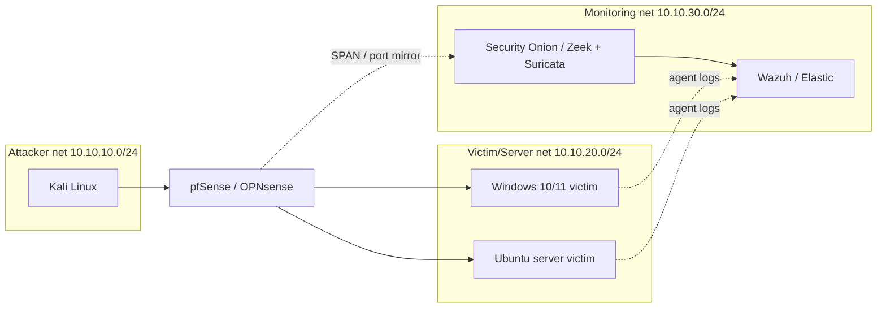

# Home SOC Detection Lab

Detect common attacks on a segmented lab network using Suricata, Zeek and a SIEM, with every detection mapped to MITRE ATT&CK and tested against captured traffic.

> **Status:** 🚧 In progress. See [PROGRESS.md](PROGRESS.md).

## Overview
I built this lab to practise the full SOC workflow end to end: generate realistic attack traffic, capture it, write detections, tune false positives and document each investigation the way a SOC analyst would.

## Architecture

Replace with your own diagram once drawn: ``

## Tools
Suricata · Zeek · Security Onion · Wazuh / Elastic · pfSense / OPNsense · Kali Linux · Atomic Red Team · Python

## Setup
Full step-by-step build guide: [docs/setup.md](docs/setup.md)
Attack simulation plan: [docs/attack-simulation-plan.md](docs/attack-simulation-plan.md)

## Detections

| Rule | Technique | MITRE ID | Tested |
|------|-----------|----------|--------|
| [LAB TCP SYN port scan](rules/suricata/local.rules) | Network Service Discovery | T1046 | ☐ |
| [LAB SSH brute force](rules/suricata/local.rules) | Brute Force | T1110 | ☐ |
| [LAB RDP brute force](rules/suricata/local.rules) | Brute Force | T1110 | ☐ |
| [LAB DNS long query](rules/suricata/local.rules) | DNS (C2 / tunneling) | T1071.004 | ☐ |
| [LAB PE download over HTTP](rules/suricata/local.rules) | Ingress Tool Transfer / Phishing | T1105 / T1566 | ☐ |
| [Encoded PowerShell](rules/sigma/win_powershell_encoded_command.yml) | PowerShell | T1059.001 | ☐ |
| [Windows failed logons](rules/sigma/win_failed_logon_bruteforce.yml) | Brute Force | T1110 | ☐ |
| [Linux SSH failed password](rules/sigma/lnx_sshd_failed_password.yml) | Brute Force | T1110 | ☐ |
| [RDP logon from attacker subnet](rules/sigma/win_rdp_logon_from_lab_attacker.yml) | Remote Desktop Protocol | T1021.001 | ☐ |
| [Remote service install](rules/sigma/win_remote_service_install.yml) | SMB/Admin Shares, Service Execution | T1021.002 / T1569.002 | ☐ |
| [Certutil download](rules/sigma/win_certutil_download.yml) | Ingress Tool Transfer | T1105 | ☐ |
| [Beacon detector](scripts/beacon_detector.py) | Application Layer Protocol (C2) | T1071 | ☐ |

Full mapping: [mitre-mapping.md](mitre-mapping.md)

## Results
Screenshots and alert samples are in [docs/screenshots](docs/screenshots). Investigation write-ups are in [reports/](reports).

## Lessons Learned
_Fill this in as you go: what failed, what you tuned, what you would improve next._

## Disclaimer
For educational use in an isolated lab only. All attack activity was performed against systems I own, on networks with no route to the internet or production systems.

## License
MIT. See [LICENSE](LICENSE).
